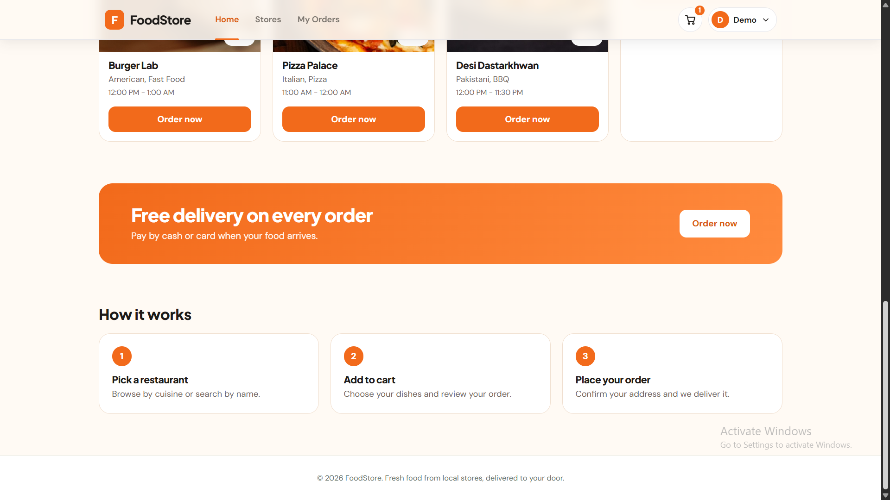
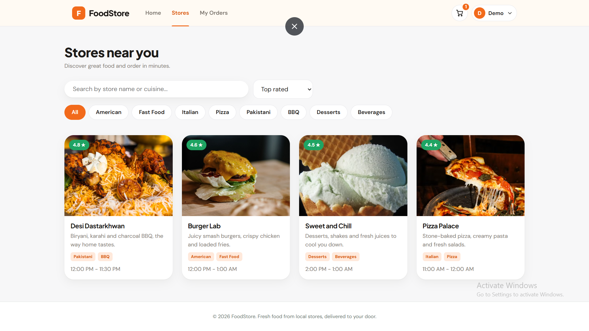
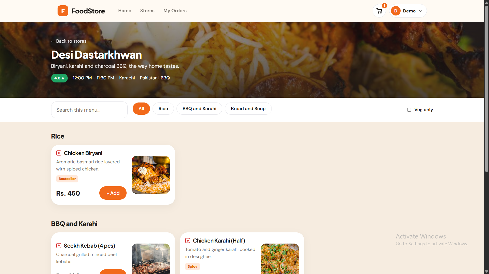
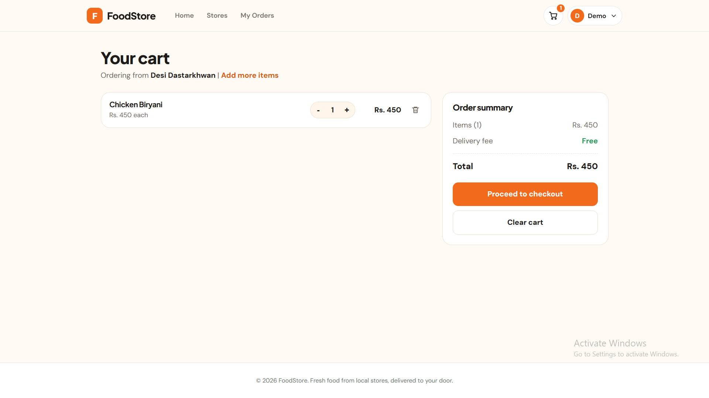
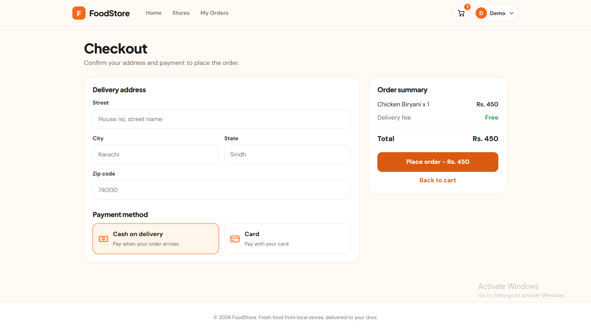
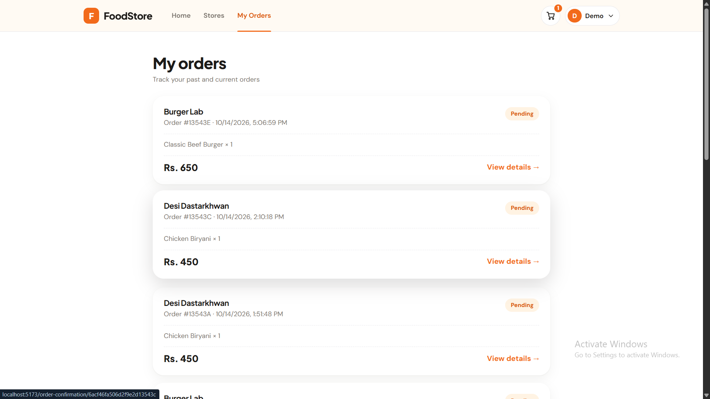
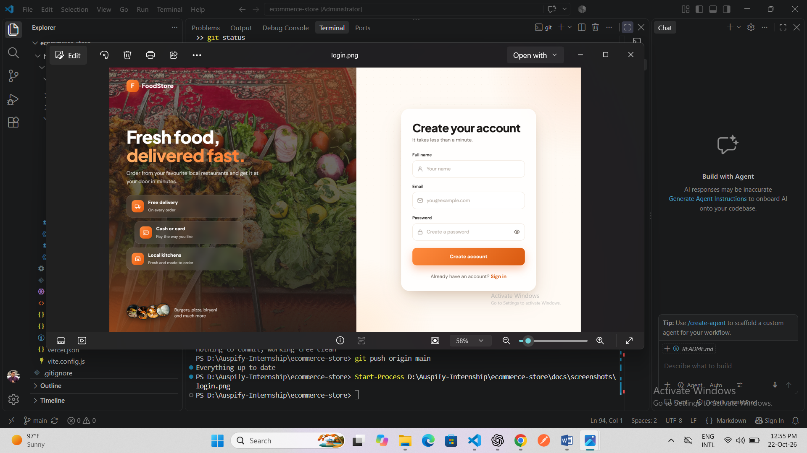

# RestaurantOS - Food Delivery App

A full-stack food delivery platform built for the Auspify Technologies Full Stack internship. Customers browse restaurants, add dishes to a cart and place orders. Managers, kitchen staff and admins each get their own dashboard.

## Features

- Browse restaurants, search by name or cuisine, filter by category
- Restaurant menus with categories, veg / non-veg markers and add-to-cart
- Cart, checkout with delivery address, cash or card payment
- Order confirmation and order history
- Role-based access: customer, manager, kitchen, admin
- Manager tools: order dashboard and menu management
- JWT authentication

## Tech stack

- **Frontend:** React, Vite, React Router, Axios
- **Backend:** Node.js, Express
- **Database:** MongoDB Atlas (Mongoose)

## Getting started

### 1. Clone

```bash
git clone <your-repo-url>
cd ecommerce-store
```

### 2. Backend

```bash
cd backend
npm install
cp .env.example .env     # then fill in your own values
npm run dev
```

The API runs on `http://localhost:5000`.

### 3. Frontend

```bash
cd frontend
npm install
cp .env.example .env
npm run dev
```

The app runs on `http://localhost:5173`.

## Environment variables

See `backend/.env.example` and `frontend/.env.example`. Never commit your real `.env` files.

## Demo accounts

| Role | Email | Password |
|------|-------|----------|
| Manager | manager1@foodstore.com | _add password_ |
| Customer | customer@foodstore.com | _add password_ |

## API overview

| Route | Purpose |
|-------|---------|
| `/api/auth` | Register, login, logout, current user |
| `/api/restaurants` | List and view restaurants |
| `/api/menu/:restaurantId` | Menu for a restaurant |
| `/api/cart` | Get cart, add items |
| `/api/orders` | Place and view orders |
| `/api/users` | Admin: list users |

## Screenshots

| Home | Stores |
|------|--------|
|  |  |

| Restaurant menu | Cart |
|-----------------|------|
|  |  |

| Checkout | My orders |
|----------|-----------|
|  |  |



## Author

Dev - Auspify Internship, Cohort 16
